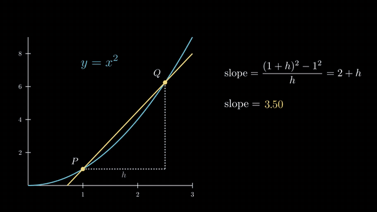

# manim-kit

A small CLI that makes [Manim Community](https://www.manim.community/) — the
3Blue1Brown-style math animation engine — a one-command affair: scaffold a
scene from a template, list the scenes in a file, render at a quality preset,
open the result. Ships a Claude Code skill with a Manim cheat sheet so an AI
session can write and render animations for you.

Built on the [cli-tools-kit](https://github.com/Probst1nator/cli-tools-kit)
installer protocol (`--advertise`, `--install`, `--install-skill`).

## Example

[](docs/readme_demo.mp4)

The GIF is a silent 8-second excerpt. Click it for the full 46-second video with sound
([docs/readme_demo.mp4](docs/readme_demo.mp4), 720p, 2.3 MB): a title intro, then the
derivative of x² as the limit of a secant. The narration is Google Gemini TTS with the
voice **Puck** (AI-generated). The music is "Cylinder Five" by Chris Zabriskie, licensed
under CC BY 4.0, <https://chriszabriskie.com>.

The scene is [examples/readme_demo.py](examples/readme_demo.py). To render it again you
need a Gemini API key (see [Voices](#voices)):

```bash
manim-kit render examples/readme_demo.py ReadmeDemo -q m --voice gemini-flash-tts:Puck
```

## Install

```bash
git clone <this repo> ~/manim-kit && cd ~/manim-kit
pip install -r requirements.txt      # cli-tools-kit, for --install only
python3 manim_kit.py --install       # bash alias `manim-kit` + Claude skill
source ~/.bashrc
manim-kit setup                      # creates .venv with manim, runs doctor
```

`manim_kit.py` itself is stdlib-only. Manim lives in a tool-owned `.venv/`
next to the script; the host Python never sees it.

### System requirements

- Python ≥ 3.11 (manim ≥ 0.20 needs it), `ffmpeg`.
- **ManimPango has no Linux wheels** and compiles against Pango/Cairo headers.
  On Debian/Ubuntu: `sudo apt install libpango1.0-dev libcairo2-dev pkg-config`.
  `manim-kit doctor` tells you when this is missing.
- Optional: a LaTeX install with `latex` + `dvisvgm` for `Tex`/`MathTex`.
  `Text()` works without it.

## Usage

```bash
manim-kit new pythagoras --template graph     # → pythagoras.py, class Pythagoras
manim-kit list pythagoras.py                  # scene classes in the file
manim-kit render pythagoras.py                # 1080p60 by default
manim-kit render pythagoras.py -q l           # draft, 480p15, seconds
manim-kit render pythagoras.py Pythagoras -q h --preview   # final 1080p60, auto-open
manim-kit render pythagoras.py --all --format gif
manim-kit render pythagoras.py -s             # last frame as PNG
manim-kit open pythagoras.py                  # newest render of that file
manim-kit render f.py -- --disable_caching    # anything after -- goes to `manim render`

manim-kit render pythagoras.py --no-music     # skip the ambient bed (on by default)
manim-kit music list                          # library, with what is cached
manim-kit music fetch                         # pre-download every bundled track
manim-kit music add ~/my_track.mp3            # use your own audio

manim-kit new lecture --template narrated     # a scene that speaks
manim-kit render lecture.py --voice phonon:Hadley
manim-kit render lecture.py --srt             # also write subtitles
manim-kit render lecture.py --no-ducking      # flat music bed
manim-kit voice list                          # the voices, and which work here
manim-kit voice say "A quick audition."       # preview without rendering
manim-kit voice setup                         # cache the local Phonon models and voices
```

Templates: `basic` (shapes + transform), `text` (Text + MathTex highlight),
`graph` (Axes, plot, ValueTracker dot), `threed` (surface + camera orbit),
`narrated` (VoiceoverScene with two spoken blocks and a bookmark),
`sim` (plays back simulation snapshots: a toy wave solver, two runs stacked and in sync,
each with an image, a curve and a readout; `SIM_DATA=DIR` plays your own `.npz` files).
The skill's section *Animating your own simulation or data* explains the pattern.

Quality presets: `l` 480p15 · `m` 720p30 · `h` 1080p60 · `p` 1440p60 · `k` 2160p60.
Output goes to `media/videos/<file-stem>/<res>/<Scene>.mp4` next to the scene
file; `render` prints the paths it produced.

## Music

Renders get a background track under the finished MP4 by default, mixed with ffmpeg:
looped or trimmed to the exact video length, faded in and out, at `volume=0.12` (about
-18 dB) so a later voice-over still sits on top. Pass `--no-music` for a silent render;
`--music-gain` changes the level, `--no-music-fade` drops the fades. The video stream is
copied, not re-encoded, so it costs a second regardless of quality preset; if ffmpeg
fails the silent render is left intact. Music is skipped automatically for `--last-frame`,
`--format png` and `--format gif` — no audio track.

Tracks are fetched on first use into `~/.cache/manim-kit/music/` and checked against the
SHA-256 in `music.json`. The tracks are not committed; the only audio in this repo is
the finished demo video in `docs/`. The bundled set is six
[Chris Zabriskie](https://chriszabriskie.com) tracks (*Cylinders*, *The Black Hole*,
*Reappear*) under **CC BY 4.0 / CC BY 3.0**, mirrored on archive.org. Each render with
music prints the attribution line, which has to go into your video description;
`manim-kit music credits` reprints them.

The actual 3Blue1Brown soundtrack by Vincent Rubinetti is **all rights reserved** — free
to listen to, licensed per project through
[his form](https://vincerubinetti.github.io/using-the-music-of-3blue1brown/), sometimes
for a fee. It cannot be shipped or auto-fetched by a tool, so it is not in the manifest.

## Narration

`manim-kit render` can speak the scene. A narrated scene subclasses
[manim-voiceover](https://github.com/ManimCommunity/manim-voiceover)'s `VoiceoverScene`
and wraps each animation in a `with self.voiceover(...)` block: the line is synthesized
before the block runs, the animation is told how long the clip is, and the block waits at
the end until the voice has finished. The narration sits in the scene file next to the
animation it describes, so there is no separate cue sheet to keep in sync.

```python
from manim import *
from manim_voiceover import VoiceoverScene
from manim_kit_voice import default_service, subcaptions_wanted

class Derivative(VoiceoverScene):
    def construct(self):
        self.set_speech_service(default_service(), create_subcaption=subcaptions_wanted())
        ax = Axes(); curve = ax.plot(lambda x: x**2)
        with self.voiceover("The derivative measures how fast a function changes.") as t:
            self.play(Create(ax), Create(curve), run_time=t.duration)
        with self.voiceover("Watch the point <bookmark mark='go'/> slide along it.") as t:
            self.wait_until_bookmark("go")
            self.play(MoveAlongPath(dot, curve), run_time=t.get_remaining_duration())
```

Clips are cached under `media/voiceovers/` next to the scene and keyed by the text plus
the voice settings, so re-rendering an unchanged line costs nothing and editing one
re-synthesizes only that line. Bookmarks are placed by text position rather than by
transcription: accurate to a fraction of a second, and no Whisper in the venv.

### Voices

A voice spec is `backend:voice[:lang]`. Two backends ship in this version:

| Spec | Lang | Notes |
|---|---|---|
| `phonon:Harper` | en | **default** (`--voice en`) — American female, confident and friendly |
| `phonon:Hadley` | en | American female, even and kind |
| `phonon:Trevor` | en | American male, warm |
| `phonon:Spencer` | en | British male, light and patient |
| `phonon:Annika:de` | de | **German default** (`--voice de`) — German female, sparky |
| `phonon:Anton:de` | de | German male |
| `gemini-flash-tts:Puck` | en | best prosody, paid |
| `gemini-flash-tts:Leda` | en | calm, paid |
| `gemini-flash-tts:Kore:de` | de | German female, firm and clear, paid |
| `gemini-flash-tts:Aoede:de` | de | German female, softer, paid |
| `gemini-flash-tts:Charon:de` | de | German male, paid |

`phonon` runs gradium's [Phonon 40M multilingual](https://huggingface.co/gradium/phonon-40m-multilingual)
model locally on the CPU through [ptts](https://pypi.org/project/ptts/), in English and
German, offline and free. Every voice in `voice.json`'s `phonon` section works, not only
the ones above. Old `kokoro-v1:<id>` specs from before 2026-10-26 still work: they map
to the Phonon voice of the same accent and gender (`af_heart` → Hadley, `af_sarah` →
Harper) and print a note.

`gemini-flash-tts` calls Gemini's `gemini-3.1-flash-tts-preview`, at roughly $0.006 per
two-sentence line ($1/1M input text tokens plus $20/1M audio output tokens). Piper, gTTS
and edge-tts are deliberately out — see [NARRATION-DESIGN.md](NARRATION-DESIGN.md) for
the licence reasoning.

### Voice licences

- **Phonon 40M multilingual** output is **CC BY-NC 4.0**: non-commercial use only, and the
  video needs the credit "Phonon by Gradium, CC BY-NC 4.0". `render` prints that line
  after a narrated render.
- When 40M cannot load (the model is gated on Hugging Face), English falls back to
  **Phonon 31M English**, Apache-2.0, with the same voice names. German then fails with
  an error that names the gemini backend. The stderr line at model load says which model
  spoke.
- **Commercial work uses the `gemini-flash-tts` backend**, in English and in German.
  Google's Gemini API terms put no attribution requirement on generated speech.

Selection order: `--voice SPEC`, then `$MANIM_KIT_VOICE`, then the `default` in
`voice.json`. A bare language code in either place (`--voice de`) picks that language's
entry in `language_defaults`: English is `phonon:Harper`, German is
`phonon:Annika:de`. That file is committed
and the repo is synced, so the default is fleet-wide; it also carries the curated voice
list and the Phonon pins: the two models and the voice catalog at fixed Hub revisions,
the quantization, the voice names and the Kokoro-name map.

`manim-kit voice setup` downloads the Phonon 40M model (about 40 MB) and the voices
above into the Hugging Face cache, `~/.cache/huggingface/hub`. The 40M model needs
`hf auth login` with an account that accepted its terms; without that, setup fetches
Phonon 31M English instead and reports German as failed. After that, narration runs
offline: a model or voice is loaded from the local cache, and a download is only tried
when the Hub answers within 3 s, so a dead network gives an error instead of a hang.

The Gemini backend needs an API key. The names are tried in the order
`GEMINI_API_KEY_PAID`, `GEMINI_API_KEY`, `GOOGLE_API_KEY`, so a paid key wins over a
free-tier one (the free tier allows 10 TTS requests a day). Each name is looked up in the
environment first, then in the file named by `$MANIM_KIT_ENV_FILE`, then in
`~/.config/manim-kit/.env` (`$XDG_CONFIG_HOME/manim-kit/.env` when that is set). The scene
process runs from the scene's directory, which usually has no `.env` of its own. The
per-user file also works for renders started from cron or a script, where a variable set
in an interactive shell's rc file is missing.

### Music under a voice

A narrated render already has an audio track, so the music is mixed into it instead of
replacing it: the bed plays at `volume=0.12` and a `sidechaincompress` keyed on the voice
dips it about 8 dB while someone speaks and lets it back up in the pauses — threshold
0.03, ratio 8, attack 20 ms, release 500 ms. `--no-ducking` keeps the bed flat. A silent
render is mixed exactly as before, and the video stream is still copied, never re-encoded.

`--srt` writes a subtitle file next to the MP4.

## Claude Code skill

`--install` (or `--install-skill` alone) writes `~/.claude/skills/manim-kit/SKILL.md`
from the `SKILL_MD_CONTENT` constant in `manim_kit.py`. The skill carries the
commands above, a workflow (draft with `-q l`, ship at the default `-q h`), a Manim CE
cheat sheet (mobjects, animations, positioning, updaters, plots, text, 3D) and
the usual gotchas (ManimGL names that don't exist in Manim CE, `Transform` vs
`ReplacementTransform`, raw strings for TeX). The `--advertise` probe reports
`skill_status` so the AutomatedAlchemy installer GUI can offer a refresh when
the bundled skill changes.

## Tests

```bash
.venv/bin/pip install pytest
.venv/bin/python -m pytest tests
```

On Windows the venv interpreter is `.venv\Scripts\python.exe`:

```powershell
.venv\Scripts\python.exe -m pip install pytest
.venv\Scripts\python.exe -m pytest tests
```

`tests/test_render.py` really renders the basic template at `-q l` and skips
itself when manim is not installed in `.venv`.

## License

MIT — see [LICENSE](LICENSE). That covers this code, not the narration it makes: audio
from the default `phonon` voices is CC BY-NC 4.0 (see [Voice licences](#voice-licences)).
